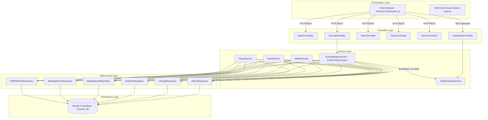
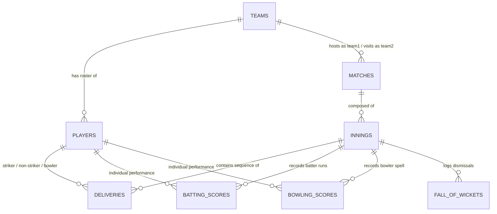

# Web Technology Academic Assignment Report
## Project Title: CricPulse — Real-Time Cricket Score Management System

**Academic Course:** Web Technology Laboratory / Full-Stack Enterprise Engineering  
**Application Name:** CricPulse  
**Technology Stack:** Java 17 LTS, Spring Boot 3.2.5, Spring Data JPA, Hibernate, MySQL 8.0, HTML5, CSS3, JavaScript, Bootstrap 5.3, Chart.js, Server-Sent Events (SSE)  

---

### Executive Summary
**CricPulse** is a responsive, real-time live cricket score management platform designed to solve the challenges of recording, aggregating, and broadcasting fast-paced cricket match events. Unlike naive scoring tools that merely increment integer fields, CricPulse incorporates an **event-driven cricket scoring engine** where every delivery is treated as an immutable ball event. Aggregate team totals, individual player batting scorecards, bowling spells, fall of wickets, run rates, and strike rotations are computed dynamically in compliance with the Laws of Cricket.

The system features real-time communication between the backend and browser clients through **Server-Sent Events (SSE)** with an automatic fallback polling mechanism, ensuring that multiple viewers observe instantaneous score updates as soon as the administrator records a delivery.

---

## 1. Introduction

Cricket is one of the world's most widely followed team sports, characterized by intricate scoring rules, multiple dismissal modes, legal versus illegal deliveries (wides, no-balls), and dynamic strike rotation between overs and during runs. Modern digital score platforms must deliver real-time updates to thousands of concurrent users with sub-second latency.

The **CricPulse** project demonstrates the implementation of a full-stack, enterprise-grade web application using the modern Java ecosystem (Spring Boot 3.x) paired with a normalized relational database (MySQL 8) and a clean, lightweight, framework-free web interface (Vanilla JavaScript, Bootstrap 5, and Chart.js).

---

## 2. Project Objectives

1. **Authentic Cricket Rules Enforcement**: Build an engine supporting dot balls, singles, boundaries (4s and 6s), illegal deliveries (wides and no-balls), byes, leg-byes, and various dismissal types (bowled, caught, LBW, run-out, stumped).
2. **Dynamic Strike Rotation & Over Tracking**: Automatically swap striker and non-striker on odd runs and at the completion of each 6-ball over.
3. **Delivery Rollback (Undo Capability)**: Provide an atomic undo mechanism allowing scorers to roll back erroneous scoring entries without corrupting batsman or bowler figures.
4. **Persistent Relational Storage**: Model normalized entities in MySQL 8 with foreign keys, indexes, and transactional consistency (`@Transactional`).
5. **Real-Time Data Distribution**: Stream live match deltas to web clients via Server-Sent Events (SSE) with seamless fallback to client-side polling.
6. **Responsive UI/UX**: Deliver a modern dark navy and green dashboard with clear visual hierarchies, glowing live indicators, and data visualizations.
7. **Production Documentation**: Document all endpoints using OpenAPI 3.0 / Swagger UI and verify business logic via automated JUnit 5 tests.

---

## 3. Technologies Used & Rationale

| Layer | Technology | Version | Purpose & Rationale |
|---|---|---|---|
| **Backend** | Java | 17 LTS | Modern LTS Java featuring records, pattern matching, and superior performance. |
| **Framework** | Spring Boot | 3.2.5 | Enterprise microservice framework providing dependency injection and embedded Tomcat. |
| **Persistence** | Spring Data JPA / Hibernate | 3.2.x / 6.4 | Object-Relational Mapping (ORM) reducing boilerplate data access logic. |
| **Database** | MySQL | 8.0 | High-performance relational database with ACID guarantees and foreign key constraints. |
| **API Docs** | Springdoc OpenAPI | 2.5.0 | Automated OpenAPI 3.0 specification and interactive Swagger UI interface. |
| **Monitoring** | Spring Boot Actuator | 3.2.5 | Production-ready health, info, and metrics endpoints (`/actuator/health`). |
| **Frontend UI**| HTML5 / CSS3 / Vanilla JS | ES6+ | Lightweight, fast-loading, framework-free architecture ideal for Web Technology studies. |
| **CSS Library**| Bootstrap | 5.3.3 | Responsive grid layout, modals, and navigation components. |
| **Charts** | Chart.js | 4.x | Interactive radar, bar, and doughnut charts for player comparison and top performers. |
| **Streaming** | Server-Sent Events (SSE) | HTTP/1.1 | Unidirectional real-time event streaming from server to client with zero polling overhead. |
| **Build Tool** | Apache Maven | 3.9+ | Standard dependency management and reproducible build lifecycle. |

---

## 4. System Architecture

The application adopts the **Layered Controller-Service-Repository Pattern**:

### Architectural Highlights:
1. **Separation of Concerns**: Controllers only handle HTTP request mapping and DTO serialization; all scoring algorithms reside inside `ScoringEngineService`.
2. **DTO Layer**: Entities are never leaked to external clients. Dedicated DTOs (`DeliveryRequestDto`, `LiveMatchSnapshotDto`, `ScorecardResponseDto`) decouple internal relational models from the API surface.
3. **Global Exception Handling**: Centralized `GlobalExceptionHandler` converts domain exceptions (`ResourceNotFoundException`, `InvalidScoringException`, `BadRequestException`) into standard JSON error objects.

---

## 5. Database Design & Data Modeling

The relational schema is normalized to Third Normal Form (3NF) to eliminate data redundancy while maintaining referential integrity.

### Entity Relationship Diagram

### Database Tables & Descriptions:
1. **`teams`**: Primary information of teams (name, short code, primary theme color, logo).
2. **`players`**: Player profiles with role (BATSMAN, BOWLER, ALL_ROUNDER, WICKET_KEEPER), batting/bowling style, jersey number, and career baseline statistics.
3. **`matches`**: Fixtures, format (T20, ODI, TEST), overs limit, toss winner, toss decision, status (SCHEDULED, LIVE, INNINGS_BREAK, COMPLETED), winner, and result margin.
4. **`innings`**: Match innings record (innings 1 or 2), total runs, wickets, legal balls, target runs, extras breakdown, and active crease player pointers.
5. **`deliveries`**: Individual ball event logging over number, ball in over, batter runs, extra type, extra runs, wicket details, fielder, commentary, and sequence order.
6. **`batting_scores`**: Batting scorecard rows capturing runs, balls faced, 4s, 6s, strike rate, dismissal text, and out status.
7. **`bowling_scores`**: Bowling figures capturing legal balls bowled, maidens, runs conceded, wickets, and economy rate.
8. **`fall_of_wickets`**: Timeline of wickets fallen (wicket number, team score, over, and dismissed batsman).
9. **`admin_users`**: Administrative credentials for securing the scoring console.

---

## 6. Cricket Scoring Engine Implementation

### A. Delivery Classification & Legal Ball Counting
Cricket rules state that illegal deliveries do not advance the official over ball count:
- **Wide**: `isLegalDelivery = false`. Extras + 1 (or more), bowler conceded runs + total runs. Batsman faces zero balls. Over ball count stays unchanged.
- **No-Ball**: `isLegalDelivery = false`. Extras + 1. Batsman faces delivery and gets personal credit for runs scored off the bat. Over ball count stays unchanged.
- **Byes & Leg-Byes**: `isLegalDelivery = true`. Extra runs added to team total, but **not charged to the bowler**. Batsman balls faced increments, but personal runs remain zero.

### B. Strike Rotation Algorithm
Strike rotates under two conditions:
1. **Runs Taken (Odd vs Even)**: If the batsmen cross an odd number of times (1, 3, or 5 runs), the striker and non-striker swap ends.
2. **End of Over (Ball 6)**: When `legalBalls % 6 == 0`, the over concludes. Batsmen switch ends on the pitch, and the bowling team appoints a new bowler from the opposite end.

### C. Undo Last Delivery Algorithm
When an error occurs, the scorer can invoke `undoLastDelivery()`:
1. The system fetches the delivery with the highest `sequenceOrder` for the current innings.
2. Deducts delivery runs and extras from the innings total.
3. Decrements `legalBalls` if the delivery was legal.
4. Deducts runs conceded and wickets from the bowler's spell.
5. Reverts balls faced, runs, and boundary counts from the batsman's scorecard.
6. If a wicket was taken, decrements innings wickets, reinstates the batsman to `isOut = false`, and purges the corresponding `FallOfWicket` entry.
7. Restores previous striker and non-striker crease positions.
8. Deletes the `Delivery` event record.
9. Publishes the restored snapshot to all connected clients via SSE.

---

## 7. User Interface & Feature Walkthrough

The UI uses a **Pitch Emerald (`#00E676`)** and **Midnight Navy (`#070D1F`)** palette.

1. **Home Dashboard (`index.html`)**:
   - Displays a prominent **Featured Match Card** with a pulsing live badge, live scores, required run rate, and ball chips.
   - Live, upcoming, and completed match cards organized into filterable sections.
2. **Live Match Center (`match-live.html`)**:
   - Big score widget (`142/3 in 15.4 ov`).
   - Active crease tables for striker, non-striker, and current bowler.
   - Color-coded recent deliveries strip (Boundary: gold, Wicket: red, Extras: purple).
   - Ball-by-ball commentary timeline.
   - Real-time indicator showing SSE status.
3. **Full Scorecard (`scorecard.html`)**:
   - Tabbed view for 1st and 2nd innings.
   - Batting figures with dismissal details, did-not-bat tags, extras summary, bowling figures, and fall-of-wickets table.
4. **Player Profiles & Statistics (`players.html`)**:
   - Roster browser across 6 international teams.
   - Modal with a **Chart.js Radar Chart** evaluating player skill ratings (Batting Power, Boundary Hitting, Strike Rotation, Bowling Control, Economy, and Impact).
   - Clearly separates **Career Baseline Stats** from **Tournament Live Recorded Figures**.
5. **Admin Scoring Console (`admin.html`)**:
   - Admin login view (`admin` / `admin123`).
   - Live delivery scoring buttons for runs (0, 1, 2, 3, 4, 6), extras (Wide, No-ball, Bye, Leg-bye), and wickets.
   - Wicket modal specifying dismissal type, fielder, and incoming batsman.
   - One-click **Undo Last Ball** button.
   - Match scheduler for creating new fixtures.

---

## 8. Testing & Quality Assurance

Automated unit and integration tests were developed using JUnit 5, Spring Boot Test, and MockMvc running on an in-memory H2 database profile.

### Test Results Summary:
- **Total Tests Executed:** 16
- **Passed:** 16
- **Failures:** 0
- **Errors:** 0
- **Execution Time:** ~19.2s

### Tested Scenarios:
1. `testDotBall`: Verified zero runs added and batsman balls faced incremented.
2. `testFourAndSix`: Verified boundary counters increment and bowler runs conceded increase.
3. `testWideAndNoBall`: Verified legal ball count does not advance on illegal deliveries.
4. `testByeAndLegBye`: Verified byes are not charged to the bowler's runs conceded.
5. `testWickets`: Verified bowler gets credit for bowled/caught, but not for run-outs.
6. `testStrikeRotationOnSingle`: Verified striker and non-striker swap on odd runs.
7. `testOverCompletion`: Verified batsmen switch ends on the 6th legal delivery of an over.
8. `testChaseResult`: Verified match completes immediately when the chasing team reaches the target score.
9. `testUndoLastDelivery`: Verified all score components and batsman figures roll back cleanly.
10. `testInvalidScoringInputs`: Verified rejection of duplicate striker/non-striker or bowler batting.
11. `testGetTeams`, `testGetLiveMatches`, `testGetCompletedMatches`: REST API verification.
12. `testAdminLoginSuccess`, `testAdminLoginFailure`: Security authentication verification.

---

## 9. Advantages & Key Highlights

1. **Lightweight & High Performance**: Zero dependency on heavy frontend frameworks (React/Angular); fast page loads and simple hosting via Spring Boot static resources.
2. **True Live Scoring Engine**: Computes scores using authentic cricket rules rather than static field increments.
3. **Resilient Real-Time Updates**: Combines Server-Sent Events (SSE) with an automated 3-second fallback polling mechanism.
4. **Zero-Configuration Demo**: Pre-seeded with 6 teams, 36 players, a live T20 thriller, and historical completed matches.
5. **Interactive Data Visualization**: Includes Chart.js radar and bar charts for player analytics.

---

## 10. Limitations & Future Scope

### Limitations:
- Single-scorer concurrency: Multiple scorers updating the same match simultaneously is prevented by optimistic locking, but multi-scorer conflict resolution is not implemented.
- Duckworth-Lewis-Stern (DLS) method for rain-shortened matches is not yet modeled.

### Future Scope:
1. **External Cricket API Integration**: Plug in third-party live cricket feeds (e.g. CricAPI, Sportmonks).
2. **WebSocket Support**: Upgrade bidirectional live scoring communication.
3. **PDF Scorecard Export**: Generate official tournament match summary sheets using iText or JasperReports.
4. **Push Notifications**: Browser web push alerts for wickets, boundaries, and match milestones.

---

## 11. Conclusion

The **CricPulse — Real-Time Cricket Score Management System** fulfills all requirements of a modern Web Technology project. By combining a robust Spring Boot 3 backend, relational MySQL storage, and a responsive frontend with Server-Sent Events, CricPulse delivers an engaging, authentic cricket scoring experience. Automated tests confirm that scoring rules, strike rotations, and rollback actions perform accurately.
