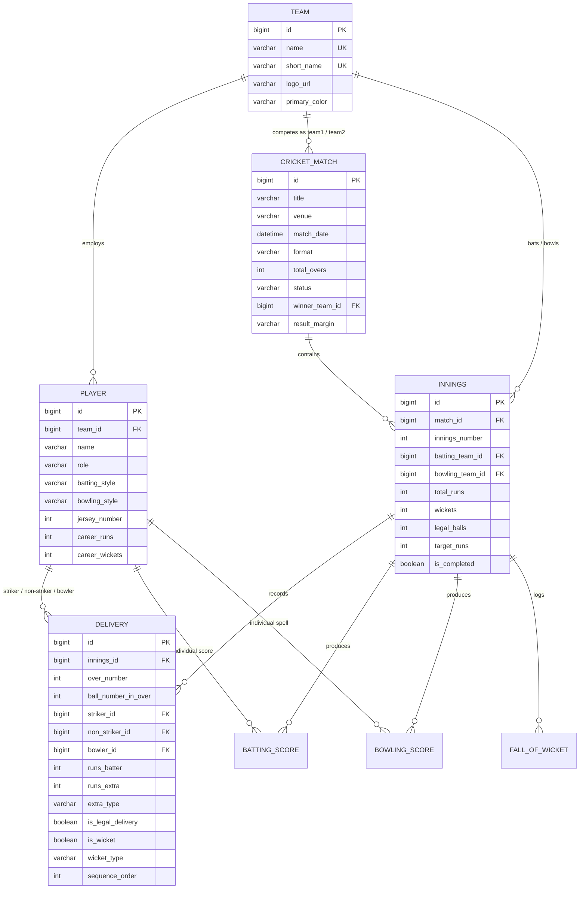

# CricPulse — Real-Time Cricket Score Management System

[](https://adoptium.net/)
[](https://spring.io/projects/spring-boot)
[](https://www.mysql.com/)
[](http://localhost:8080/swagger-ui/index.html)
[](LICENSE)

**CricPulse** is an enterprise-grade, full-stack cricket live scoring and match management platform designed as a comprehensive **Web Technology college project**. Built with **Java 17**, **Spring Boot 3.x**, **Spring Data JPA**, **Hibernate**, and **MySQL 8**, it integrates a real-time cricket scoring engine with event-driven strike rotation, automatic legal delivery counting, boundary tracking, and rollback capabilities.

Live match updates are streamed to browsers in real time using **Server-Sent Events (SSE)** with an automatic fallback polling mechanism (every 3 seconds).

---

## Table of Contents
1. [Key Features](#key-features)
2. [Technology Stack](#technology-stack)
3. [System Architecture Diagram](#system-architecture-diagram)
4. [Entity Relationship (ER) Diagram](#entity-relationship-er-diagram)
5. [Prerequisites & System Setup](#prerequisites--system-setup)
6. [Database Configuration & Seed Data](#database-configuration--seed-data)
7. [Running the Application](#running-the-application)
8. [REST API Documentation & Swagger UI](#rest-api-documentation--swagger-ui)
9. [Cricket Scoring Engine Rules](#cricket-scoring-engine-rules)
10. [Unit & Integration Testing](#unit--integration-testing)
11. [Troubleshooting](#troubleshooting)

---

## 1. Key Features

- **Home Match Central Dashboard (`index.html`)**:
  - **Realistic 2024 International Calendar**: Powered by authentic fixtures (India tour of South Africa 2024, New Zealand tour of India 2024, Pakistan tour of Australia 2024, and England tour of Pakistan).
  - **Day-Based Categorization & Filter Tabs**:
    - **Live Today**: Games active today with real-time scorelines and in-play metrics.
    - **Tomorrow**: Upcoming fixtures scheduled for tomorrow with start times and venues.
    - **All Upcoming**: Full schedule across upcoming bilateral series.
    - **Recent Results**: Finished matches archived with result margins and POTM awards.
  - Featured live thriller hero card with animated pulsing live badge.
  - Current scores, run rates (CRR), required run rates (RRR), target chase information.
  - Format selector (T20, ODI, TEST).

- **Live Match Center (`match-live.html`)**:
  - Live match scoreboard (`IND 202/8`, `SA 145/6 in 17.0 ov • Need 58 runs in 18 balls`).
  - **Multi-Match Switcher**: Switch between active live games (`IND vs SA` & `IND vs NZ`) with one click.
  - Active batters table highlighting current striker (`*`) with balls faced, 4s, 6s, and strike rate.
  - Active bowler table with overs, maidens, runs conceded, wickets, and economy rate.
  - Color-coded recent deliveries strip (Boundary: gold/green, Wicket: red, Extras: purple).
  - Chronological ball-by-ball commentary timeline.
  - Live SSE connection indicator with automatic reconnection and fallback polling.

- **Full Detailed Scorecard (`scorecard.html`)**:
  - 1st Innings and 2nd Innings tabs.
  - Batting figures with dismissal commentary (e.g. `c Stubbs b Coetzee`, `not out`).
  - Extras breakdown (wides, no-balls, byes, leg-byes, penalty).
  - Bowling spell figures (Overs, Maidens, Runs, Wickets, Economy).
  - Fall of Wickets (FOW) table.
  - Did Not Bat (DNB) player lists.

- **Player Profiles & Statistics (`players.html`)**:
  - Squad rosters across 6 international teams with accurate modern squads.
  - Clear distinction between **Career Baseline Stats** and **Tournament Live Recorded Figures**.
  - Interactive **Chart.js** performance matrix (Radar chart for player skill ratings and bar/doughnut charts for top tournament run scorers and wicket takers).

- **Match Results Archive (`results.html`)**:
  - Completed match archive with winning team, victory margins, and Player of the Match honors.
  - Format-based filtering.

- **Admin Scoring Console (`admin.html`)**:
  - Session-based admin authentication (`admin` / `admin123`).
  - Live delivery scoring board: dot balls (0), singles (1), doubles (2), triples (3), boundaries (4, 6).
  - Extras management: Wide, No-ball, Bye, Leg-bye.
  - Dismissal recording modal: Bowled, Caught, LBW, Run Out, Stumped, Hit Wicket.
  - Crease batsman and bowler dropdown selectors with automatic strike rotation.
  - **One-click Undo Delivery**: Roll back erroneous scoring events instantly!
  - **Reset to 2024 International Fixtures**: One-click database reload of realistic current fixtures.
  - Innings completion and match declaration tools.
  - Match scheduler to create new matches and set up toss decisions.

---

## 2. Technology Stack

| Layer | Technologies & Tools |
|---|---|
| **Backend Framework** | Java 17 LTS, Spring Boot 3.2.5 |
| **REST APIs & Web** | Spring Web MVC, Springdoc OpenAPI 2.5 (Swagger UI) |
| **Data Persistence** | Spring Data JPA, Hibernate ORM, HikariCP |
| **Database** | MySQL 8.0 (Production), H2 in-memory (Unit/Integration Testing) |
| **Validation & Health** | Spring Validation (Hibernate Validator), Spring Boot Actuator |
| **Real-Time Streaming** | Server-Sent Events (SSE) + 3s Fallback Polling |
| **Frontend UI** | HTML5, CSS3, Vanilla JavaScript (ES6+), Bootstrap 5.3, Bootstrap Icons |
| **Data Visualization** | Chart.js 4.x |
| **Build Tool** | Apache Maven 3.9+ |
| **Testing** | JUnit 5, MockMvc, AssertJ |

---

## 3. System Architecture Diagram

```mermaid
graph TD
    subgraph Client Browser
        UI1[Home Dashboard - index.html]
        UI2[Live Match Center - match-live.html]
        UI3[Full Scorecard - scorecard.html]
        UI4[Player Analytics - players.html]
        UI5[Admin Scoring Console - admin.html]
        API_JS[Centralized API Client - api.js]
        SSE_CLIENT[SSE EventSource Listener]
    end

    subgraph Spring Boot Application (Port 8080)
        REST_CTRL[REST Controllers]
        LIVE_CTRL[LiveStreamController - SSE Emitters]
        SCORING_SVC[ScoringEngineService - Cricket Rules Engine]
        MATCH_SVC[MatchService & TeamService]
        SSE_SVC[SseBroadcastService]
        SECURITY[Global Exception Handler & Validation]
        REPOS[Spring Data JPA Repositories]
    end

    subgraph Database Layer
        MYSQL[(MySQL 8.0 Database: cricpulse_db)]
        H2[(In-Memory H2 DB for Unit Tests)]
    end

    UI1 & UI2 & UI3 & UI4 & UI5 --> API_JS
    API_JS -->|HTTP REST: JSON| REST_CTRL
    UI2 -->|SSE Stream| LIVE_CTRL
    REST_CTRL --> SCORING_SVC & MATCH_SVC
    SCORING_SVC -->|Broadcast Score Update| SSE_SVC
    SSE_SVC --> LIVE_CTRL
    SCORING_SVC & MATCH_SVC --> REPOS
    REPOS --> MYSQL
```

---

## 4. Entity Relationship (ER) Diagram



---

## 5. Prerequisites & System Setup

- **Java Development Kit**: JDK 17 (or 21). Verify with:
  ```powershell
  java -version
  ```
- **Apache Maven**: Version 3.8+ or 3.9+. Verify with:
  ```powershell
  mvn -version
  ```
- **MySQL 8.0**: Server running on port `3306`. Verify service is active:
  ```powershell
  Get-Service -Name '*mysql*'
  ```

---

## 6. Database Configuration & Seed Data

### 1. Database Creation
In MySQL command line or Workbench:
```sql
CREATE DATABASE IF NOT EXISTS cricpulse_db CHARACTER SET utf8mb4 COLLATE utf8mb4_unicode_ci;
```

### 2. Configure `application.properties`
The default settings connect to MySQL using environment variables or fallbacks:
```properties
spring.datasource.url=${DB_URL:jdbc:mysql://localhost:3306/cricpulse_db?createDatabaseIfNotExist=true&useSSL=false&allowPublicKeyRetrieval=true&serverTimezone=UTC}
spring.datasource.username=${DB_USERNAME:root}
spring.datasource.password=${DB_PASSWORD:@nKush56}
```
*(Customize `spring.datasource.username` and `spring.datasource.password` to match your local MySQL configuration).*

### 3. Automated Seed Data
Upon application startup, `SeedDataService` automatically seeds:
- **Admin User**: `admin` / `admin123`
- **6 International Teams**: India (IND), South Africa (SA), New Zealand (NZ), Australia (AUS), Pakistan (PAK), England (ENG).
- **Realistic 2024 Star Players**: Real rosters with accurate roles, jersey numbers, styles, and career records (Sanju Samson, Suryakumar Yadav, Tilak Varma, Gerald Coetzee, Heinrich Klaasen, Rachin Ravindra, Mitchell Santner, Washington Sundar, Saud Shakeel, Sajid Khan, etc.).
- **Live Matches Today**:
  - `1st T20I — India tour of South Africa 2024` (Kingsmead, Durban) — IND 202/8 (Samson 107 off 50); SA chasing 203: 145/6 in 17.0 ov (Coetzee 23*, Jansen 12*).
  - `2nd Test — New Zealand tour of India 2024` (MCA Stadium, Pune) — NZ 259 & 198/5; IND 156 (Sundar 7/59, Santner 7/53).
- **Matches Tomorrow**:
  - `1st ODI — Pakistan tour of Australia 2024` (MCG, Melbourne • Tomorrow 09:00 AM IST).
  - `2nd T20I — India tour of South Africa 2024` (St George's Park, Gqeberha • Tomorrow 07:30 PM IST).
- **Recent Results**:
  - `1st Test — New Zealand tour of India 2024` (Bengaluru) — NZ won by 8 wickets (Rachin Ravindra POTM).
  - `3rd Test — England tour of Pakistan 2024` (Rawalpindi) — PAK won by 9 wickets (Series won 2-1).

---

## 7. Running the Application

### 1. Build and Run via Maven
Inside the project root directory (`.../scratch/cricpulse`):
```powershell
mvn spring-boot:run
```

### 2. Access the Application
Once the application boots:
- **Home Dashboard**: [http://localhost:8080/](http://localhost:8080/)
- **Live Match Center**: [http://localhost:8080/match-live.html](http://localhost:8080/match-live.html)
- **Full Scorecard**: [http://localhost:8080/scorecard.html](http://localhost:8080/scorecard.html)
- **Player Profiles & Stats**: [http://localhost:8080/players.html](http://localhost:8080/players.html)
- **Match Results Archive**: [http://localhost:8080/results.html](http://localhost:8080/results.html)
- **Admin Scoring Console**: [http://localhost:8080/admin.html](http://localhost:8080/admin.html)
- **Interactive Swagger UI**: [http://localhost:8080/swagger-ui/index.html](http://localhost:8080/swagger-ui/index.html)
- **Actuator Health Endpoint**: [http://localhost:8080/actuator/health](http://localhost:8080/actuator/health)

---

## 8. REST API Documentation & Swagger UI

All 23 endpoints are documented with OpenAPI 3.0 annotations in Swagger UI at `http://localhost:8080/swagger-ui/index.html`.

### API Endpoint Summary Table

| Category | HTTP Method | Endpoint | Description |
|---|---|---|---|
| **Teams** | `GET` | `/api/teams` | List all teams with their player rosters |
| | `GET` | `/api/teams/{id}` | Get team details by ID |
| | `POST` | `/api/teams` | Create a new cricket team |
| | `PUT` | `/api/teams/{id}` | Update existing team information |
| | `DELETE` | `/api/teams/{id}` | Delete a team |
| **Players** | `GET` | `/api/players` | List all players (optional `teamId` filter) |
| | `GET` | `/api/players/{id}` | Get player profile by ID |
| | `GET` | `/api/players/{id}/statistics` | Career baseline & live tournament recorded stats |
| **Matches** | `GET` | `/api/matches` | List all matches (optional format filter) |
| | `GET` | `/api/matches/{id}` | Get match summary by ID |
| | `GET` | `/api/matches/live` | List all active LIVE matches |
| | `GET` | `/api/matches/today` | List all matches taking place TODAY |
| | `GET` | `/api/matches/tomorrow` | List all matches scheduled for TOMORROW |
| | `GET` | `/api/matches/upcoming` | List all SCHEDULED matches |
| | `GET` | `/api/matches/completed` | List all COMPLETED matches |
| | `GET` | `/api/matches/{id}/summary` | Quick summary banner for a match |
| | `GET` | `/api/matches/{id}/scorecard` | Full 1st & 2nd innings scorecard with DNB & FOW |
| | `GET` | `/api/matches/{id}/live-snapshot` | Real-time match snapshot (used by polling) |
| **Scoring** | `GET` | `/api/matches/{id}/innings` | Get innings list for a match |
| | `GET` | `/api/innings/{id}/deliveries` | Get chronological ball events for an innings |
| | `POST` | `/api/innings/{id}/deliveries` | Record single delivery event (runs, wickets, extras) |
| | `POST` | `/api/innings/{id}/undo-last-delivery` | Roll back most recent delivery event |
| | `POST` | `/api/innings/{id}/complete` | Complete an innings and advance game state |
| **Live Stream**| `GET` | `/api/matches/{id}/live-stream` | Server-Sent Events (SSE) real-time score stream |
| **Admin** | `POST` | `/api/admin/login` | Authenticate admin credentials |
| | `POST` | `/api/admin/reseed` | Reset and reload authentic 2024 international fixtures |
| | `POST` | `/api/admin/matches` | Schedule a new match and init 1st innings |
| | `POST` | `/api/admin/matches/{id}/start` | Mark scheduled match as LIVE |
| | `POST` | `/api/admin/matches/{id}/finish` | Finalize match and declare winner / margin |
| | `DELETE` | `/api/admin/matches/{id}` | Delete match record |

---

## 9. Cricket Scoring Engine Rules

The backend scoring engine (`ScoringEngineService.java`) implements authentic cricket scoring laws:
1. **Legal Delivery Counting**:
   - `NONE`, `BYE`, `LEG_BYE`: Count as legal balls (advance over count, e.g. `15.1`, `15.2`).
   - `WIDE`, `NO_BALL`: Do **NOT** count as legal balls. The delivery count stays unchanged and requires re-bowling.
2. **Bowler Charges & Stats**:
   - Bowler is charged with batter runs, wides, and no-balls.
   - Bowler is **NOT** charged with byes or leg-byes.
   - Bowler is credited with wickets on: `BOWLED`, `CAUGHT`, `LBW`, `STUMPED`, `HIT_WICKET`.
   - Bowler is **NOT** credited with `RUN_OUT` or `RETIRED_HURT`.
3. **Strike Rotation**:
   - **Odd Runs (1, 3, 5)**: Batsmen cross ends; striker and non-striker swap.
   - **End of Over (Ball 6)**: Batsmen switch ends for the next over; striker and non-striker swap.
4. **Target Chase & Match Completion**:
   - When 2nd innings team total runs $\ge$ target, match immediately completes with victory margin (e.g. `England won by 7 wickets`).
   - If 10 wickets fall or overs limit reached, winner is computed with run margin (e.g. `India won by 18 runs`) or `Match Tied`.
5. **Undo Delivery Mechanism**:
   - Rolls back innings score, legal balls, batter runs/balls/boundaries, bowler runs/wickets, and reinstates dismissed batsmen.

---

## 10. Unit & Integration Testing

The project includes automated tests for all critical scoring flows and REST endpoints using JUnit 5, Spring Boot Test, and MockMvc with an in-memory H2 database profile (`application-test.properties`).

Execute tests with:
```powershell
mvn test
```

### Verified Test Suite (16/16 Passed):
1. `testDotBall`: 0 runs, 1 legal ball, batter balls faced increments.
2. `testFourAndSix`: Boundary tracking and bowler runs conceded.
3. `testWideAndNoBall`: Illegal deliveries do not advance legal delivery count.
4. `testByeAndLegBye`: Legal deliveries not charged to bowler.
5. `testWickets`: Bowler credited on bowled/caught, not on run-out.
6. `testStrikeRotationOnSingle`: Odd runs swap striker and non-striker.
7. `testOverCompletion`: 6th delivery triggers end-of-over end change.
8. `testChaseResult`: Reaching target finishes match with wickets margin.
9. `testUndoLastDelivery`: Cleanly rolls back score, wickets, and batsman stats.
10. `testInvalidScoringInputs`: Rejects duplicate striker/non-striker or bowler as batsman.
11. `testGetTeams`: Verifies `/api/teams` returns all seeded teams.
12. `testGetLiveMatches`: Verifies `/api/matches/live` returns active match.
13. `testGetCompletedMatches`: Verifies completed match archives.
14. `testAdminLoginSuccess`: Verifies valid login response and token.
15. `testAdminLoginFailure`: Verifies 400 Bad Request on invalid credentials.
16. `contextLoads`: Verifies Spring Boot ApplicationContext bootstrap.

---

## 11. Troubleshooting

| Issue | Cause | Solution |
|---|---|---|
| `Access denied for user 'root'@'localhost'` | Incorrect MySQL password in config | Verify password or update `spring.datasource.password` in `application.properties`. |
| Port 8080 already in use | Another application is running on port 8080 | Change `server.port=8081` in `application.properties` or stop the conflicting service. |
| SSE connection status shows "Live Polling Active" | Browser or proxy does not support SSE | Normal behavior: CricPulse automatically switches to 3-second fallback polling to ensure zero data disruption. |

---

*CricPulse — Live Cricket Score Management System | Web Technology Project*
# Assignment_7
